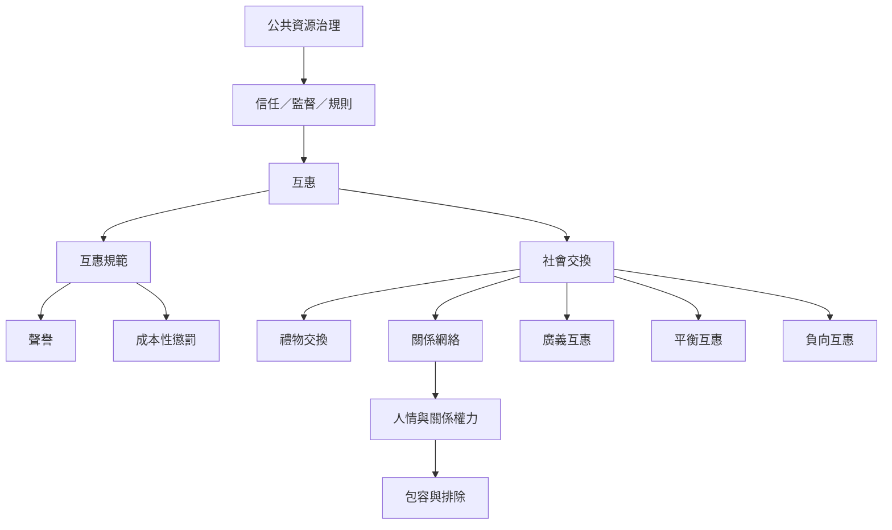

互惠從個體間的交換延伸到道德規範、禮物制度、關係網絡與公共資源治理。互惠可以連結人，也可能製造債務、排他性與權力不平等；制度設計的任務是讓合作能持續，同時保護自主、申訴與公平參與。

## Mermaid 關係圖

## 閱讀路徑
* 以[[互惠既是交換模式也是道德規範而兩者必須區分]]辨認交換、信念與規範。
* 讀[[禮物交換把給予接受與回報連成一組社會義務]]與[[薩林斯以互惠距離區分廣義平衡與負向交換]]，理解不同交換形式。
* 最後讀[[中國關係網絡中的人情互惠具有歷史與制度脈絡]]、[[多布社會的交換倫理涵蓋勞動互助禮物與衝突]]及[[制度能以互信監督與漸進制裁支持公共資源合作]]。

## 交叉連結
* 綜合筆記：[[互惠規範能維持合作也可能把人情變成債務]]、[[互助制度應讓人能互相依賴而不必把關係逐筆結清]]。
* 概念：[[互惠規範]]、[[社會交換]]、[[禮物交換]]、[[關係網絡]]、[[互賴]]。
* 實踐延伸：[[建立可見而不羞辱的互助聲譽機制]]、[[讓互惠規則保留退出自由並防止資源分配被私人關係壟斷]]。
