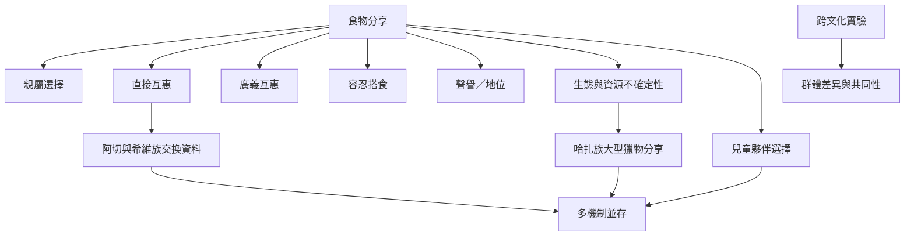

人類分享行為受到多種因素影響，包括親屬關係、需要與供給、資源生態、交換歷史、聲譽及社會規範。食物分享是研究互惠的窗口，卻不是互惠利他的同義詞。

## Mermaid 關係圖

## 閱讀路徑
* 由[[人類食物分享同時受到親屬互惠與生態條件影響]]理解競爭解釋。
* 比較[[阿切族與希維族的食物交換呈現可測量的條件性互惠]]與[[哈扎族大型獵物分享不符合簡單的風險分散互惠模型]]。
* 再讀[[哈扎兒童的自發食物分享可用來觀察夥伴選擇與社會連結]]及跨文化比較研究，理解年齡與文化脈絡。

## 交叉連結
* 綜合筆記：[[食物分享不是單一交換邏輯而是多種關係與利益重疊]]、[[跨文化互惠研究必須同時呈現差異共同性與測量限制]]。
* 概念：[[廣義互惠]]、[[親屬選擇]]、[[聲譽]]、[[合作]]。
* 實踐延伸：[[把剩食共享做成不要求人情回報的公共互助實驗]]。
