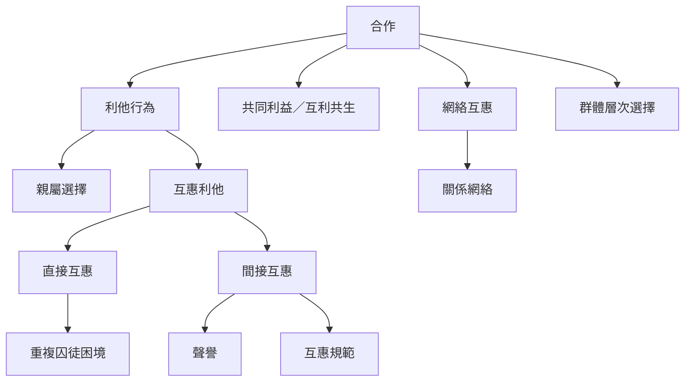

互惠利他只是合作演化的一種路徑。理解合作時，應將親屬選擇、直接互惠、間接互惠、網絡互惠與群體選擇放在同一張地圖上，並辨認共同利益或互利共生等替代解釋。

## Mermaid 關係圖

## 閱讀路徑
* 先讀[[互惠利他]]與[[利他行為]]，界定行為效果與演化模型。
* 再讀[[直接互惠]]、[[間接互惠]]和[[網絡互惠]]，比較資訊、記憶與網絡結構。
* 最後讀[[親屬選擇]]、[[互利共生]]、[[合作]]與[[社會困境]]，避免將所有合作都歸入互惠。

## 交叉連結
* 理論基礎：[[互惠利他的演化模型以延遲回報解釋非親屬間的利他行為]]、[[合作的演化包含親屬選擇直接互惠間接互惠網絡互惠與群體選擇]]。
* 機制深化：[[重複囚徒困境說明直接互惠如何在反覆互動中穩定合作]]、[[聲譽使助人者能從第三方獲得間接回報]]、[[直接與間接互惠可以放在同一模型中分析]]。
* 綜合思考：[[合作的演化不能只用互惠一種機制解釋]]、[[重複相遇降低背叛風險但無法涵蓋所有人類互助]]。
