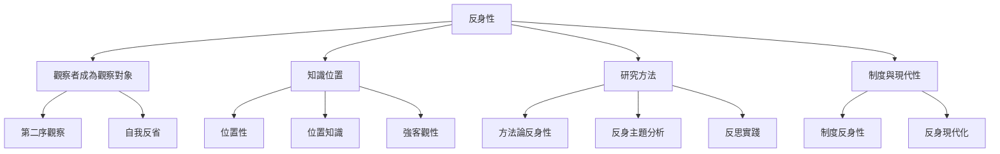

反身性可以由三個互相交織的問題理解：誰在觀察、如何觀察、觀察造成什麼後果。由此可分出個人層次的自我反省、認識論層次的觀察位置、方法論層次的研究決策，以及制度層次的社會自我修訂。這些層次相關，但不可混為一談。

閱讀此圖時，先從[[反身性讓觀察者也成為觀察對象]]出發，再比較[[反身性不等於自我反省]]、[[第二序觀察揭露觀察的選擇與盲點]]與[[反身性知識必須承認視角的局部性]]。概念定義可對照[[反身性]]、[[第二序觀察]]、[[位置性]]、[[認識論反身性]]、[[方法論反身性]]與[[制度反身性]]。
