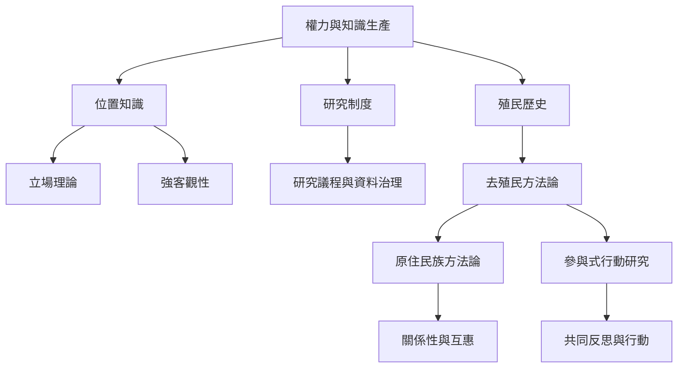

反身性與權力的關係不能只靠個人自我揭露處理。女性主義位置知識、強客觀性、原住民族方法論與參與式行動研究，都要求檢視誰有權命名問題、擁有資料、解釋經驗與決定成果用途。去殖民反身性必須進入制度與資源層次。

推薦從[[反身性知識必須承認視角的局部性]]與[[去殖民反身性必須檢查知識制度]]開始，再讀[[強客觀性要求研究者檢視自己的知識位置]]、[[參與式研究把反身性轉成共同治理]]與[[反身性不能消除權力不平等]]。概念入口：[[位置知識]]、[[立場理論]]、[[強客觀性]]、[[參與式行動研究]]、[[實踐]]與[[交織性]]。
