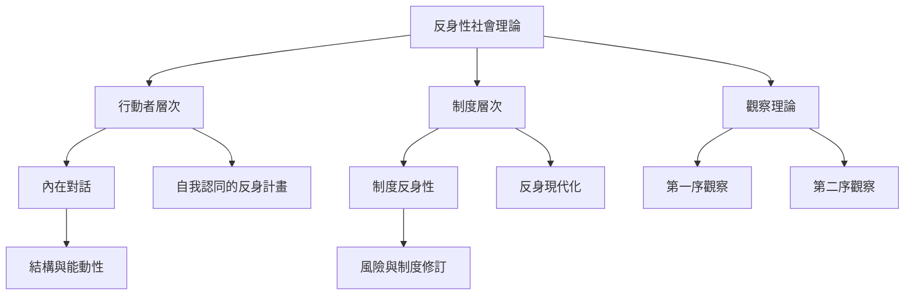

社會理論中的反身性至少有兩條重要路徑：一條以行動者的內在對話理解結構與能動性的連結；另一條以制度知識回饋與現代化副作用理解制度如何修訂自身。第二序觀察則提供觀察觀察者的分析語言。

可先讀[[反身性是日常生活中未被充分命名的社會過程]]，再比較[[晚期現代性的自我成為持續修訂的反身計畫]]、[[反身現代化是現代制度回頭改造自身基礎]]與[[第二序觀察揭露觀察的選擇與盲點]]。概念入口：[[反身性]]、[[制度反身性]]、[[反身現代化]]、[[第二序觀察]]、[[知識社會學]]。
