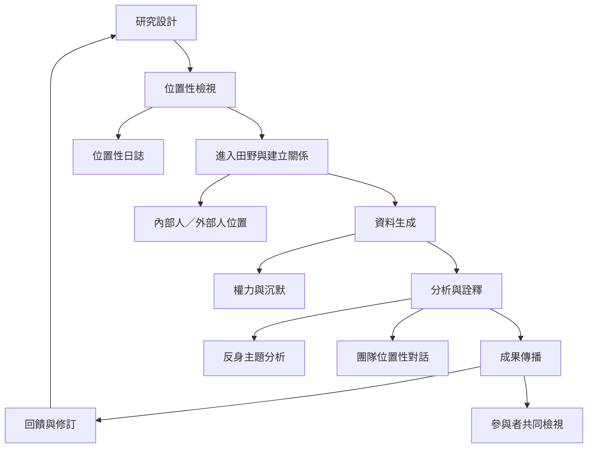

在研究實作中，反身性不是一段獨立聲明，而是一條貫穿問題設定、進入田野、資料生成、分析與傳播的軌跡。研究者的位置會改變參與關係與資料，因此需要日誌、團隊對話、共同詮釋與可追溯決策紀錄。

此圖連結[[反身性應貫穿整個研究設計]]、[[研究者位置會改變資料生成]]、[[位置性不是身分清單而是關係實踐]]、[[團隊對話能讓隱形假設浮現]]與[[把參與者納入分析而不只納入資料蒐集]]。概念入口包括[[位置性]]、[[方法論反身性]]、[[反身主題分析]]、[[內部人與外部人]]及[[民族誌]]。
