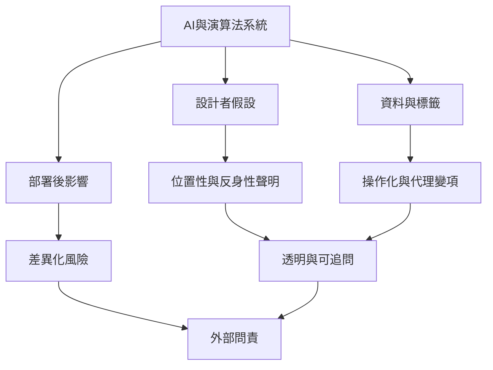

當演算法與人工智慧參與分類、預測及決策時，反身性需要延伸到程式設計者、機構與模型治理。模型不只反映資料，也反映問題定義、標籤、代理變項與目標函數的選擇。反身性聲明能使這些選擇可見，但仍需外部問責與實際效果評估。

從[[演算法設計者需要揭露分類與目標的價值前提]]與[[量化研究也必須揭露操作化與模型選擇]]開始，再接續[[反身性不能取代制度問責與效果評估]]。概念入口：[[位置性]]、[[認識論反身性]]、[[方法論反身性]]。
