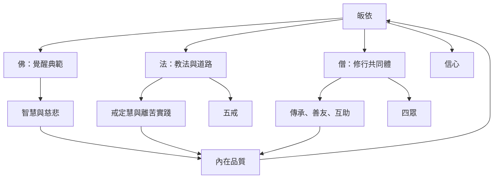

本圖整理皈依的核心結構：佛提供覺醒典範，法提供道路與方法，僧提供共同體與傳承；皈依則把三者轉成一個人的生命方向。三寶互相支持，但不應把任何一者簡化成對其他兩者的替代。

三寶地圖的關鍵不是將三個名詞拆成獨立對象，而是看見「典範—方法—共同體」如何在實踐中形成回饋循環。閱讀可由 [[三寶]]、[[佛]]、[[法]]、[[僧]] 與 [[皈依]] 開始，再進入 [[三寶彼此互依且不可互相替代]]、[[真正的依止需要從外在典範走向可培養的內在品質]]。

## 延伸
* [[摩訶那摩經把皈依三寶界定為在家弟子的入門標記]]
* [[將三寶轉譯為每日可觀察的三個實踐方向]]
* [[三皈依公式在早期佛教中標示在家弟子的身份]]
