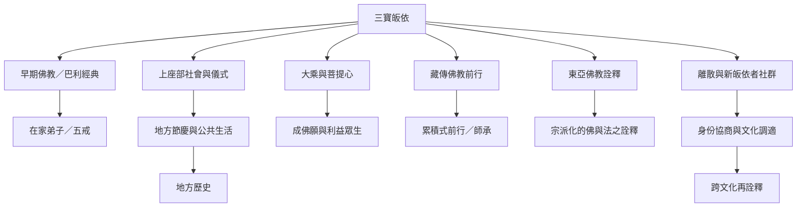

此圖以地區與傳統的比較為主，不把某一傳統當成全體佛教的標準。三寶的共同形式在不同文化中會連結到不同的儀式、經典詮釋、宗派制度與社會歷史。

比較閱讀時，先辨認相同的三寶公式，再分別分析詮釋差異與地方條件。東南亞儀式研究、藏傳前行史、淨土真宗自我說明與北美離散社群研究，屬於不同證據類型，不能互相替代。

## 延伸
* [[不同傳統可以共享三寶形式卻賦予不同的詮釋重心]]
* [[Holt以東南亞五地儀式比較佛教傳統如何回應社會變遷]]
* [[Pickens的博士論文顯示藏傳前行中的皈依兼具歷史與身份塑造功能]]
* [[淨土真宗的入門說明把三寶皈依呈現為每日的信任與同行]]
* [[離散佛教研究指出皈依身份會在跨文化移動中重新協商]]
