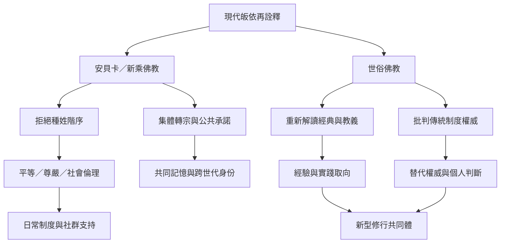

此圖聚焦近現代皈依的兩種重要再詮釋：一是把皈依作為反壓迫、集體尊嚴與社會解放的行動；二是以世俗化語言重新檢視傳統教義、儀式與權威。兩者並非同一運動，卻共同凸顯皈依如何回應具體歷史處境。

研究時須避免兩種簡化：把新乘佛教只看成政治工具，而忽略其宗教與精神生活；或把世俗佛教只看成傳統的「去宗教化」，而忽略它自身也在建立權威與共同體。應同時檢視宣言、日常實踐、制度條件與當事人敘事。

## 延伸
* [[皈依可以成為抵抗羞辱與集體重建尊嚴的行動]]
* [[當代皈依需要在傳承忠誠與批判自主之間建立張力]]
* [[研究皈依如何支持受壓迫群體重建尊嚴]]
* [[為世俗修行者設計不強迫形上信念的共同承諾]]
