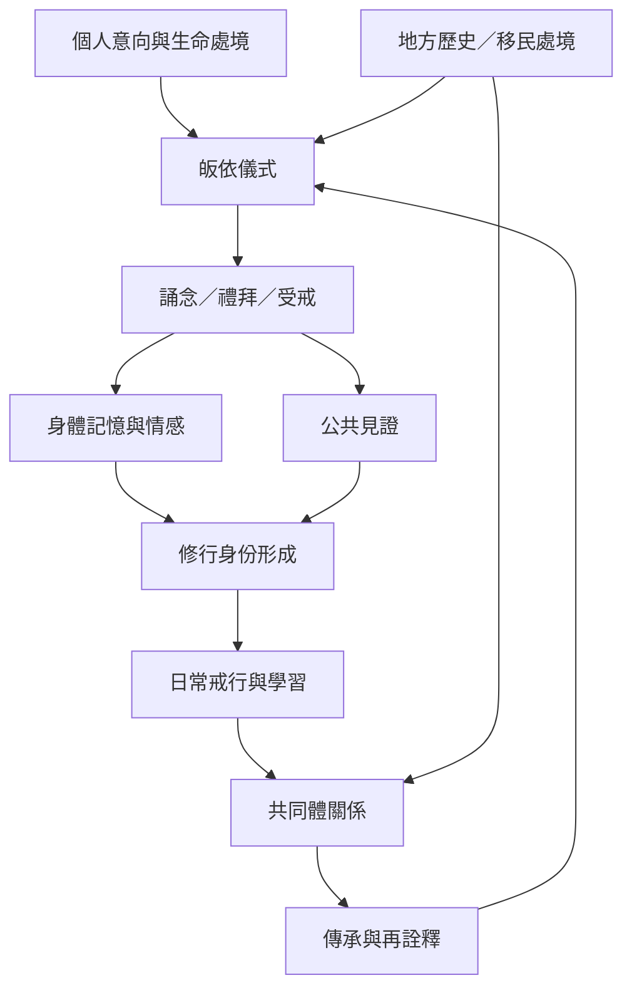

此圖把皈依從一次性的宗教宣誓，放回儀式、身體、身份、社群與日常實踐的形成過程。個人的意向與既有信念會影響儀式參與；但重複的身體行動、公開見證與共同體規範也會反過來塑造參與者。

這張圖也提醒研究者，不要只記錄儀式程序，而忽略儀式前後的變化；也不要假設儀式必然產生正向身份，因為它同樣可能製造排除、服從或身份僵化。

## 延伸
* [[儀式透過身體重複與公共見證把承諾變成身份]]
* [[跨文化皈依研究必須區分個人選擇與群體傳承]]
* [[儀式]]、[[佛教轉宗]]、[[離散佛教]]
* [[為修行社群設計互助與問責並行的僧伽公約]]
