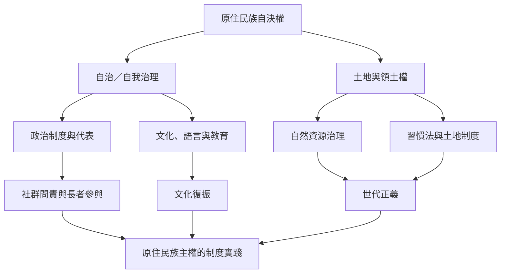

# 原住民族自決、土地與領土治理

原住民族自治不只是地方行政權，更涉及先於現代國家形成的土地關係、集體權利、文化延續、習慣法及自我治理。領土自治與原住民族主權之間有交集，但不能抹除其歷史脈絡與法律特性。

**概念連結：** [[原住民族自治]]、[[自決權]]、[[領土自治]]、[[文化自治]]、[[語言權利]]、[[資源主權]]、[[自由事先與知情同意]]。

## 參考
* [[聯合國原住民族權利宣言將自決自治與土地資源權連結]]
* [[原住民族自治應納入領土自治研究而非被排除]]
* [[自治的土地基礎不能被文化象徵取代]]

---

[[Regional_autonomy]]
