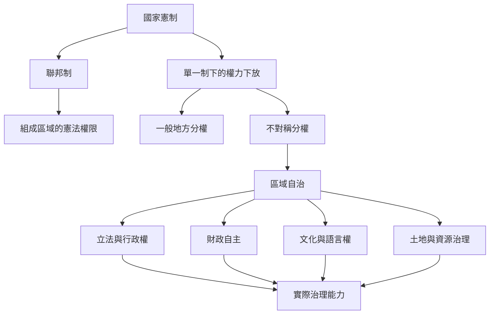

# 憲政權限與地方權力分配

區域自治位於聯邦制、權力下放、地方分權與不對稱分權的交會處。分析一套制度時，需要辨認權限由誰授予、是否受憲法保障、如何分配財政與責任，以及中央與地方之間有何爭端解決程序。

**概念連結：** [[區域自治]]、[[領土自治]]、[[聯邦制]]、[[權力下放]]、[[地方分權]]、[[不對稱分權]]、[[財政聯邦主義]]、[[補充性原則]]、[[多層次治理]]。

## 參考
* [[區域自治是多民族國家協商領土差異的一種憲政安排]]
* [[區域自治研究必須同時觀察憲法制度與實際治理能力]]
* [[自治權必須拆解為可辨識的決策權限]]

---

[[Regional_autonomy]]
