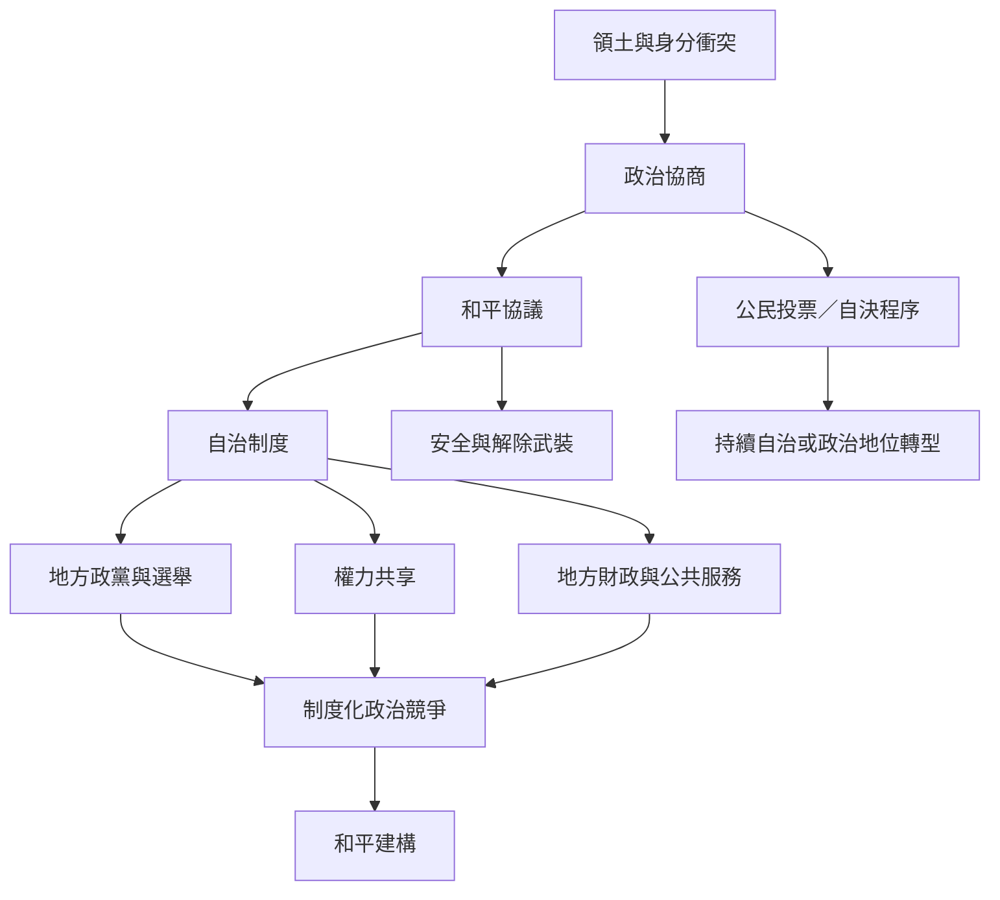

# 自決、衝突轉型與和平協議

自治常被用來協調國家統一與地方自決需求。它可能是持續性制度，也可能是衝突後的中介安排。和平協議必須把政治承諾轉化成法律、地方選舉、財政制度、安全安排與可信監督。

**概念連結：** [[自決權]]、[[分離主義]]、[[公民投票]]、[[權力共享]]、[[和平建構]]、[[區域自治]]。

## 參考
* [[亞齊和平協議將政治參與與自治制度列為終止衝突的支柱]]
* [[邦薩摩洛自治從和平協議走向民選議會仍需持續制度建構]]
* [[布干維爾公投顯示自治安排可能成為自決談判的中介階段]]

---

[[Regional_autonomy]]
