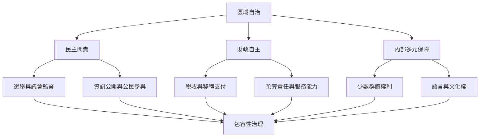

# 自治民主、財政與內部多元

自治的正當性同時來自集體自我治理與民主問責。地方財政若不足，權限便難以實現；地方多數若排除區域內部少數群體，自治也可能複製中央集權的不平等。

**概念連結：** [[區域自治]]、[[權力共享]]、[[少數群體權利]]、[[多元文化主義]]、[[財政聯邦主義]]、[[民主問責]]（延伸概念）、[[多層次治理]]。

## 參考
* [[財政自主是自治能否落地的必要條件]]
* [[自治區內部的少數群體也需要權利保障]]
* [[自治區域的民主正當性需要定期選舉與有效監督]]

---

[[Regional_autonomy]]
