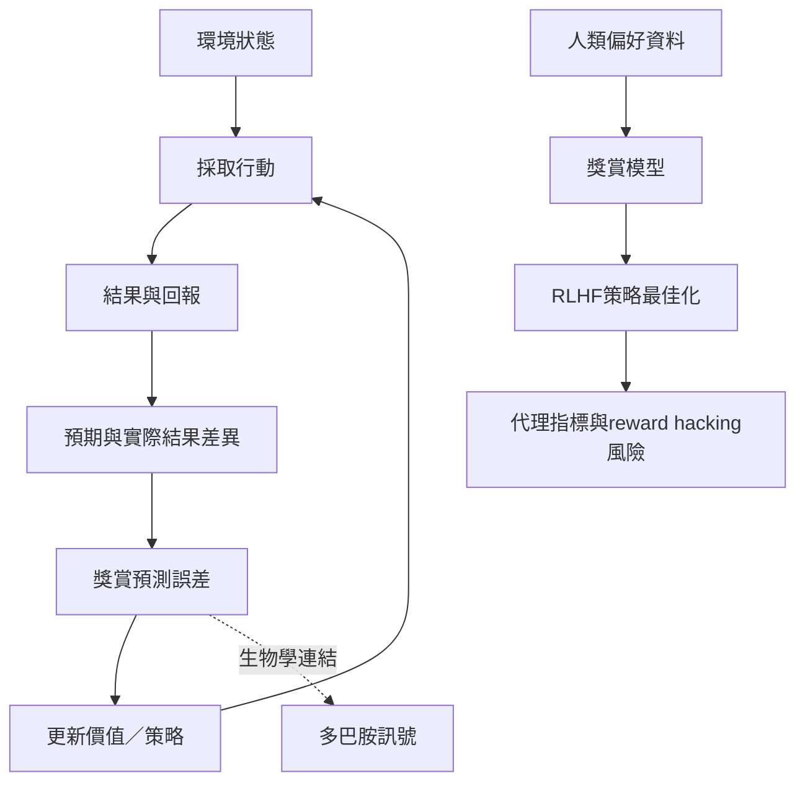

神經科學中的獎賞預測誤差與計算強化學習的時間差分更新具有重要理論連結。多巴胺活動可提供學習訊號，但其功能比單一價值誤差更豐富；RL 模型則以回報與狀態轉移形成策略，AI 中的人類回饋另引入評估者偏好與代理指標問題。

生物神經訊號、機器學習變數與人類偏好資料是不同層次，圖中的虛線僅表示理論上的啟發關係。

連結：[[多巴胺]]、[[獎賞預測誤差]]、[[強化學習]]、[[馬可夫決策過程]]、[[人類回饋強化學習]]、[[人類偏好不能被單一獎賞分數完整代表]]。
