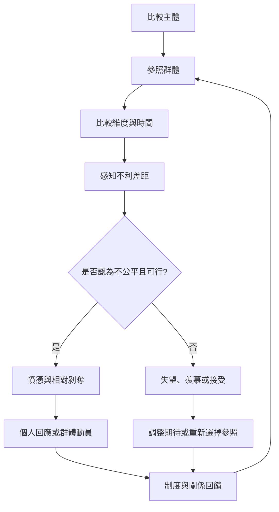

相對剝奪的形成可理解為一段關係性過程：主體選擇參照群體，在特定維度上比較，感受到不利差距，再判斷它是否不公平、是否可改變，最後形成情緒與行動傾向。研究要分清個人與群體、客觀與主觀、認知與情緒等層次。

## 核心概念
* [[term/相對剝奪]]、[[term/參照群體]]、[[term/社會比較]]、[[term/公平知覺]]
* [[term/個人相對剝奪]]、[[term/群體相對剝奪]]、[[term/向上社會比較]]、[[term/向下社會比較]]
* [[term/主觀社會地位]]、[[term/相對剝奪指數]]、[[term/相對收入]]

## 相關永久筆記
* [[note/相對剝奪是一種帶有公平判斷的比較性不利經驗]]
* [[note/客觀資源差距不會自動轉化為主觀剝奪感]]
* [[note/參照群體的選擇會改變一個人感受到的相對位置]]
* [[note/期待上升而實際機會停滯會擴大相對剝奪落差]]
* [[note/相對剝奪測量必須同時說明主體參照物與比較維度]]

## 主要文獻
* [[data/Runciman將相對剝奪連結到參照對象與社會正義判斷]]
* [[data/Festinger的社會比較理論說明人們為何尋找評價自己的標準]]
* [[data/Walker與Pettigrew提醒相對剝奪研究必須分清分析層次]]
* [[data/Yitzhaki以較高收入者的差額建構相對剝奪指數]]

本書導讀：[[Relative_deprivation]]
