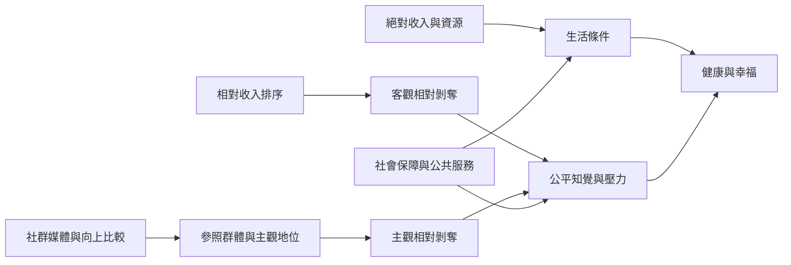

相對剝奪與健康、幸福及生活滿意的關係，必須同時考慮絕對資源、相對位置、主觀社會地位、比較群體及制度環境。客觀指數與主觀感受相關但不可互換；社群媒體比較的效果也不是單向或人人相同。

## 核心概念
* [[term/相對收入]]、[[term/收入不平等]]、[[term/相對剝奪指數]]、[[term/主觀社會地位]]
* [[term/向上社會比較]]、[[term/向下社會比較]]、[[term/分配正義]]、[[term/程序正義]]

## 相關永久筆記
* [[note/客觀資源差距不會自動轉化為主觀剝奪感]]
* [[note/收入相對位置對幸福感的影響取決於參照群體與制度脈絡]]
* [[note/社群媒體會擴張比較對象但不會讓每次比較都變成剝奪]]
* [[note/改善相對剝奪不能只勸人停止比較也要處理公平制度]]

## 延伸靈感
* [[idea/把比較對象寫出來能讓模糊的不滿變成可檢驗的問題]]
* [[idea/社群媒體使用者可以把向上比較轉為可行的學習線索]]
* [[idea/共同餐桌與互助網絡能把地位競爭轉成共享資源]]

## 主要文獻
* [[data/收入不平等與幸福感的整體關聯會因國家脈絡而異]]
* [[data/台灣研究發現客觀與主觀相對剝奪各自關聯多面向繁盛福祉]]
* [[data/台灣縱貫研究發現相對剝奪與後續多面向福祉下降相關]]
* [[data/社群媒體上的比較與嫉妒效果具有個人差異與情境條件]]

本書導讀：[[Relative_deprivation]]
