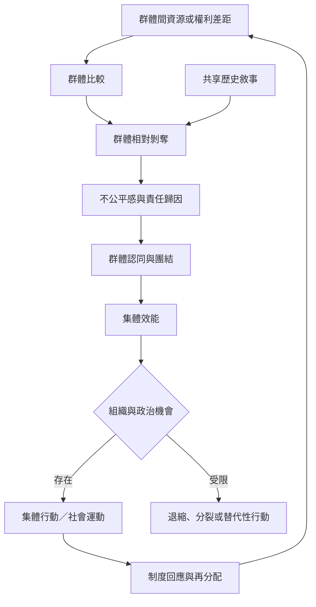

群體相對剝奪可能成為集體行動的動機來源，但並非抗爭的充分原因。群體認同、歷史敘事、責任歸因、集體效能、組織網絡與政治機會，會影響不滿是否轉為集體行動。全球案例提醒我們，制度服務分配、移民身分與公共尊嚴都可能成為比較與不公平感的焦點。

## 核心概念
* [[term/群體相對剝奪]]、[[term/群體認同]]、[[term/集體效能]]
* [[term/集體行動]]、[[term/社會運動]]、[[term/分配正義]]、[[term/社會資本]]

## 相關永久筆記
* [[note/個人相對剝奪與群體相對剝奪需要不同的解釋模型]]
* [[note/不公平感與憤懣是相對剝奪連結行動的重要橋樑]]
* [[note/集體效能能影響群體憤懣是否轉化為集體行動]]
* [[note/相對剝奪不是社會抗爭或暴力的充分原因]]
* [[note/制度性排除會讓相對剝奪不只是心理感受而是權利差距]]
* [[note/歷史敘事能把分散的不滿連結成共同的群體問題]]

## 延伸靈感
* [[idea/社區可以用共同服務地圖辨識水平不平等]]
* [[idea/研究訪談應同時蒐集客觀差距與當事人的公平敘事]]
* [[idea/倡議團體應把集體效能和可見的小成果納入策略]]

## 主要文獻
* [[data/Gurr以期待與能力落差解釋政治不滿如何累積]]
* [[data/南非的服務分配不平等與抗議及制度信任下降相關]]
* [[data/智利青年訪談顯示歷史敘事與集體效能會改寫剝奪經驗]]
* [[data/全球抗議事件研究提醒國家經濟表現不足以解釋個人參與]]

本書導讀：[[Relative_deprivation]]
