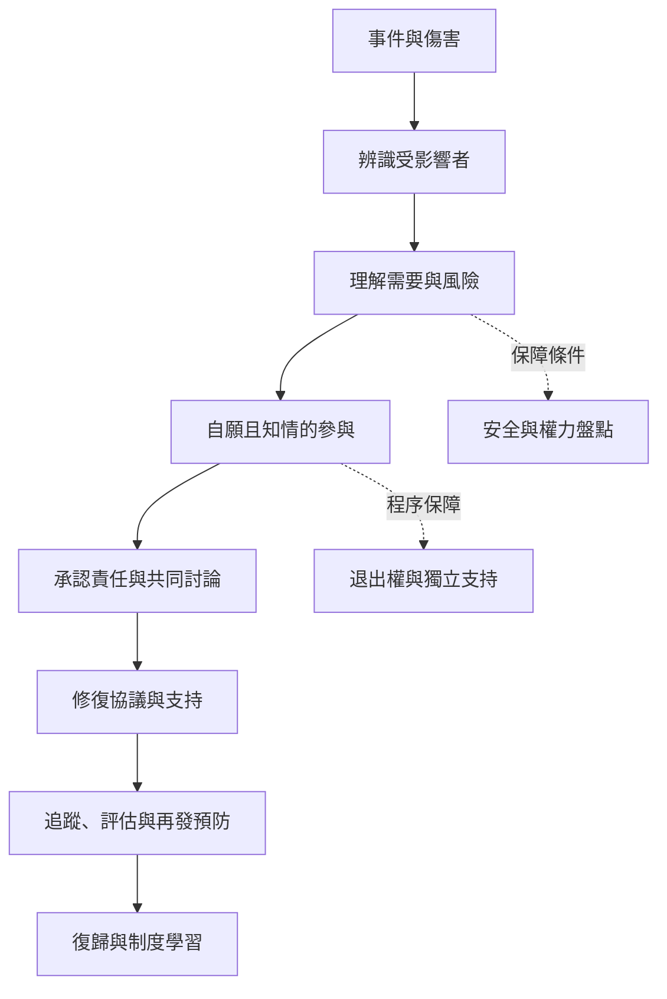

本圖整理修復式司法的核心問題：從事件與違法規範出發，辨識傷害、受影響者與需要，再分配修復責任並形成具體行動。程序的正當性取決於受害者中心、自願同意、程序公平與持續支持。

此架構不是線性必經流程：若安全或自願條件不足，程序應暫停、改採間接方式或不啟動。修復也不保證關係恢復。

## 參考
* [[修復式司法把司法焦點從違法轉向傷害與修復]]、[[受害者的需要必須被理解而不能被代替定義]]、[[修復責任必須轉化為可檢驗的行動]]、[[修復程序必須建立在自願與知情同意之上]]。
