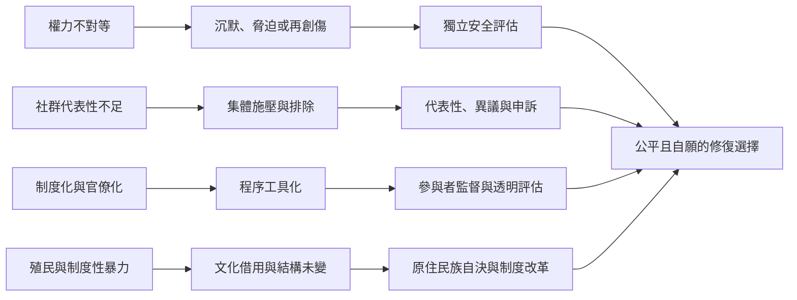

修復式司法的參與性不會自動帶來公平。社群內部可能有性別、階級、種族、年齡及資源差距；國家機關也可能借用修復話語延續控制。此圖將核心風險與保障安排放在一起，提醒設計者同時處理個人程序與結構性問題。

## 參考
* [[性別暴力案件需要獨立安全評估與受害者支持]]、[[社群參與能擴大修復但社群本身並非中立]]、[[文化轉譯不能取代原住民族的司法自主]]、[[制度化可能擴大修復資源也可能重新吸收其批判性]]。
