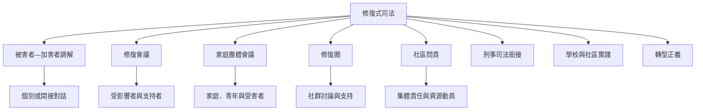

修復式司法可以透過不同程序及場域實現。以下地圖呈現常見方法如何連結參與者與制度位置。各形式不是可任意互換的工具：選擇方式前仍須評估安全、權力、文化脈絡、法律效果與參與者意願。

## 參考
* [[修復會議只是修復式司法的一種實踐形式]]、[[紐西蘭家庭團體會議結合法定程序與毛利家庭決策元素]]、[[澳洲昆士蘭社區司法團體展現原住民族參與司法的持續性]]、[[哥倫比亞和平體系把修復與真相賠償及不再發生連結]]。
