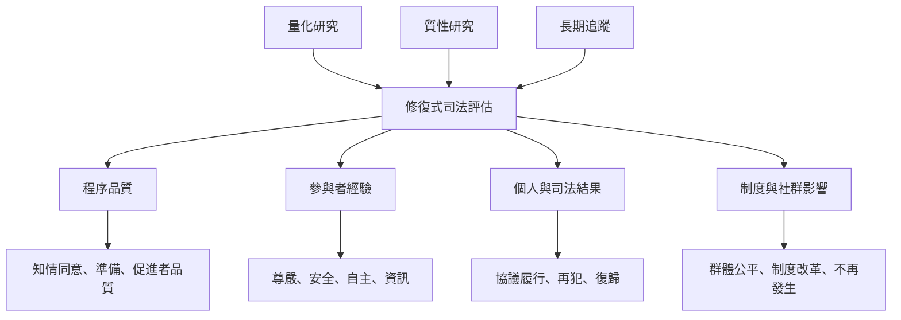

修復式司法研究需要區分不同結果，不把再犯、滿意度、心理福祉、公平性及結構改變混為同一個成效。不同研究設計回答不同問題：隨機試驗較能檢視特定方案的因果效果，質性訪談能呈現經驗與權力，系統性回顧則整理研究整體的限制與一致性。

## 參考
* [[坎培拉實驗顯示修復會議可能改善部分暴力再犯與參與者經驗]]、[[受害者心理影響系統性回顧發現修復實踐具有正向潛力]]、[[性暴力與家庭暴力修復式司法的實證證據仍極為有限]]、[[學校修復式實踐的範疇回顧指出關係改善與不平等並存]]。
