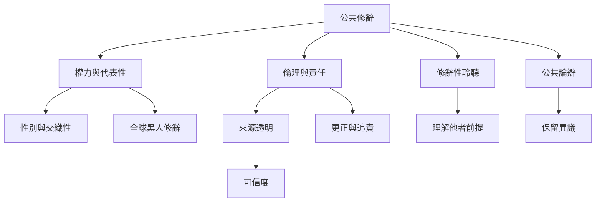

修辭同時是說服實踐與權力關係。誰被承認為可信的發言者、誰能進入公共場合、哪些經驗被視為證據，都受到性別、種族、階級與制度條件影響。負責任的修辭需要來源透明、可修正性、聆聽與對分歧的容納。

概念連結：[[可信的修辭需要證據透明與可修正的公共責任]]、[[修辭性聆聽把理解他者視為跨文化詮釋實踐]]、[[論辯可以維持分歧而不必以共識為唯一終點]]、[[女性主義修辭研究重新追問誰被承認為公共言說者]]、[[可信度 Ethos]]。

參考文獻：[[修辭性聆聽把理解他者視為跨文化詮釋實踐]]、[[女性主義修辭研究重新追問誰被承認為公共言說者]]、[[當代論辯研究已擴展到分歧視覺聲音與數位媒介]]。
