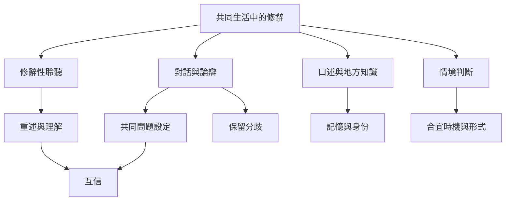

修辭不只發生在公開演說，也發生在日常協商、聚會、閱讀與共同生活中。聆聽讓人理解不同的前提；論辯程序讓分歧可被處理；口述與表演保存社群知識；情境意識則讓表達更合宜。

概念連結：[[用四步修辭性聆聽練習讓對話先理解再回應]]、[[把社群聚會設計成能容納異議的微型公共論辯場域]]、[[建立一份地方口述修辭檔案並保留講述者的脈絡]]、[[修辭性聆聽把理解他者視為跨文化詮釋實踐]]。

參考文獻：[[修辭性聆聽把理解他者視為跨文化詮釋實踐]]、[[非洲口述傳統以語言表演參與社會記憶與政治生活]]、[[修辭情境由迫切問題受眾與限制共同構成]]。
