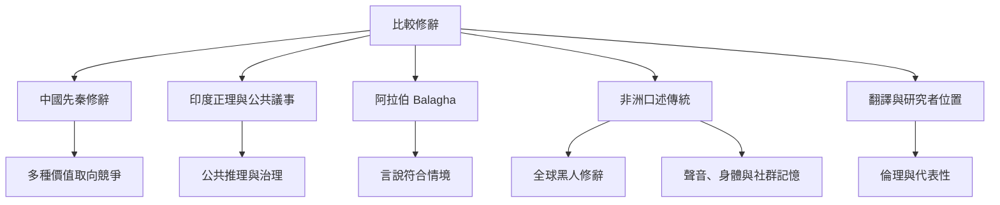

全球修辭傳統並非單一路線的分支。比較時需尊重不同社會的語言、歷史、制度與知識方式；中國先秦思想、印度正理論辯、阿拉伯 balāgha、非洲口述與黑人離散修辭，皆提供不同的問題意識與實踐形式。

概念連結：[[跨文化修辭比較必須先理解各自的歷史與問題意識]]、[[修辭不只發生於文字也發生於身體聲音與表演]]、[[修辭傳統的多樣性要求我們重新檢查誰的知識被看見]]、[[巴拉加 Balagha]]、[[口述傳統 Orality]]、[[比較修辭 Comparative rhetoric]]。

參考文獻：[[中國先秦儒道墨三家對修辭的理解彼此競爭]]、[[印度正理學與古代公共議事顯示修辭傳統不只起源於雅典]]、[[非洲口述傳統以語言表演參與社會記憶與政治生活]]、[[全球黑人修辭應納入非洲與非洲離散社群的多樣傳統]]。
