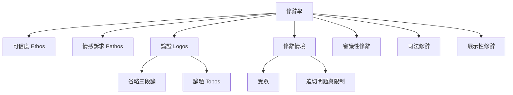

古典修辭可從說服方式、公共言說類型與具體情境三條線索理解。亞里斯多德的 ethos、pathos、logos 描述說服來源；司法、審議與展示性言說描述公共發言目的；Bitzer 的修辭情境則提醒分析者回到問題、受眾與限制。

概念連結：[[修辭學是研究情境中說服與共同理解的實踐]]、[[可信度是受眾對說話者品格與可靠性的判斷]]、[[情感是公共判斷的一部分而非理性的反面]]、[[論證必須讓受眾看見主張與理由之間的連結]]、[[修辭情境是言說與可改變情況之間的關係]]、[[受眾不只是聽眾而是能促成改變的人]]。

參考文獻：[[亞里斯多德將修辭界定為辨識各種情境中可行說服方式的能力]]、[[修辭情境由迫切問題受眾與限制共同構成]]、[[新修辭學把論證理解為爭取特定受眾認同的過程]]。
