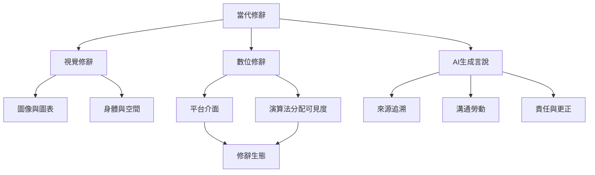

當代修辭已超越口語與書面文本。圖像、圖表、平台介面、演算法與生成式 AI 都會參與訊息的生產、可見度與說服。分析時必須同時考慮形式、流通路徑、受眾解讀與責任分配。

概念連結：[[視覺設計與圖表本身也會安排讀者如何理解證據]]、[[數位修辭會把平台與演算法納入說服情境]]、[[AI生成言說需要追問責任與傳播勞動由誰承擔]]、[[修辭生態學提醒我們言說存在於流動的社會情感網絡]]、[[視覺修辭 Visual rhetoric]]、[[數位修辭 Digital rhetoric]]。

參考文獻：[[數位修辭研究網絡科技如何改變文本與說服實踐]]、[[視覺修辭研究圖像物件與身體如何形成論證]]、[[AI修辭經濟研究提醒合成言說可能稀釋責任]]。
