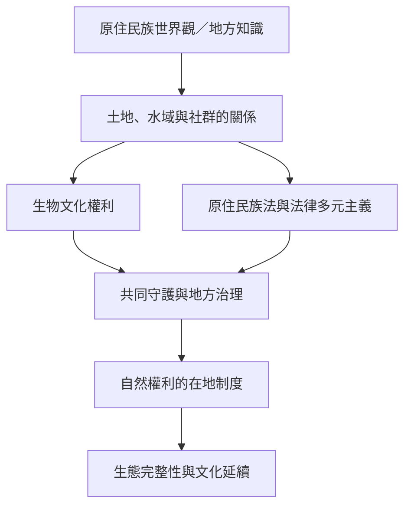

自然權利案例往往從在地社群與原住民族的關係性世界觀出發，但其制度含義不應被縮減為一條河的法律人格。更重要的是承認地方社群如何理解河流、土地、祖先與生命共同體，以及這些關係如何形成治理義務和法律秩序。旺加努伊河案例凸顯毛利 kawa 與部族決策權；哥倫比亞阿特拉托河則呈現生態系與社群文化、健康和生計的生物文化連結。

## 思與行
* 先由地方社群描述自身關係與治理歷史，再討論如何使用國家法律語言。
* 尊重每個族群內部的差異，避免以單一「原住民觀點」取代具體社群。

## 參考
* [[2024旺加努伊河治理研究指出原住民族法比法律人格更核心]]、[[2016哥倫比亞阿特拉托河案將河流權利與社群生存連結]]、[[2021加拿大麥基河由因努社群與地方政府宣告法律人格]]。
* [[生物文化權利]]、[[法律多元主義]]、[[母親地球]]、[[美好生活]]。
