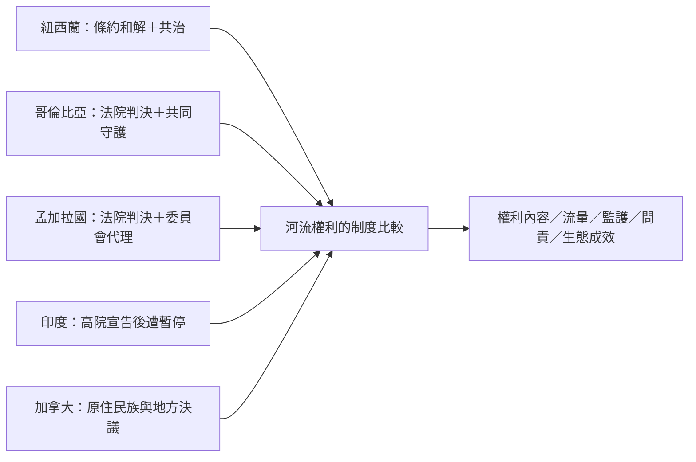

全球河流案例的差異，不只在於是否賦予法律人格，更在於河流的整體範圍、權利內容、代表者組成、法律層級和救濟可行性。紐西蘭以條約和解與共治架構承認旺加努伊河；哥倫比亞以憲法法院判決建立政府與社群共同守護；孟加拉國集中由河川委員會代理；印度裁定遭最高法院暫停；加拿大麥基河則由因努社群與地方政府通過決議。比較時必須標明法律效力差異。

## 思與行
* 所有案例比較都加註法律層級和現行效力，避免將倡議宣言與有效法規混為一談。
* 追蹤河流是否享有足以維持生態系的流量與連通權，而不只記錄人格宣告。

## 參考
* [[2017紐西蘭旺加努伊河法以整體生命體建立法律人格]]、[[2016哥倫比亞阿特拉托河案將河流權利與社群生存連結]]、[[2019孟加拉國圖拉格河判決使全國河流取得法律主體地位]]、[[2017印度恆河與亞穆納河法律人格裁定很快遭最高法院暫停]]、[[2021加拿大麥基河由因努社群與地方政府宣告法律人格]]。
* [[河流權利不能忽略維持生態的最低流量]]、[[自然監護]]、[[生態流量]]。
