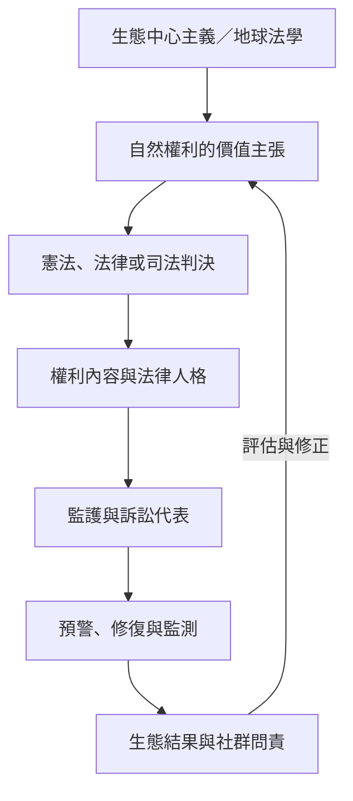

自然權利的制度路徑可以理解為：先以生態中心倫理與地球法學重新界定自然價值，再由憲法、法律或判決賦予權利，接著以法律人格、訴訟資格和監護者讓權利能被行使，最後用修復、預警、監測與問責把權利轉成實際保護。每一層都可能失效：價值若未成為法，法若未有代理人，代理人若無權限和資源，法律承認便可能停在象徵層次。

## 思與行
* 分析制度時逐層詢問：價值是否清楚、權利是否具體、誰能代表、救濟如何執行、結果如何測量。
* 不以單一法律人格宣告作為完整自然權利制度的判準。

## 參考
* [[自然權利將自然從資源客體改寫為具有內在價值的法律主體]]、[[自然權利與法律人格是不同層次的制度工具]]、[[監護制度決定自然權利能否被公平且有效地代表]]、[[自然權利訴訟需要透明程序資源與長期監測]]、[[法律承認不等於生態改善成效]]。
* [[自然權利]]、[[法律人格]]、[[自然監護]]、[[生態中心主義]]、[[地球法學]]。
