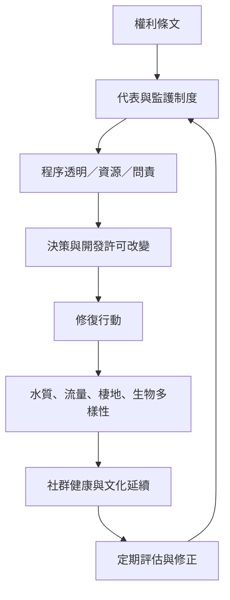

自然權利的評估應超越法條數量和勝訴次數，並追蹤法律是否改變決策權、資源分配、污染治理及生態修復。跨國比較指出，不清楚的監護責任可能使制度遭遇法律挫折；河流研究則提醒，法律人格若未保障實際水流，仍可能無法防止河川退化。制度設計需要代表問責、透明程序、穩定經費和長期指標。

## 思與行
* 同時設計制度指標與生態結果指標，避免把行政活動量誤當生態復原。
* 將生態資料與社群健康、文化和生計資料並列，檢查成本是否公平分配。

## 參考
* [[2024全球14個自然權利案例顯示監護責任設計影響制度存續]]、[[2020歐唐納指出河流獲得人格仍可能失去水流權]]、[[2025魏斯與穆林斯主張自然治理應從法律人格轉向權力重組]]。
* [[自然權利訴訟需要透明程序資源與長期監測]]、[[法律承認不等於生態改善成效]]、[[監護制度決定自然權利能否被公平且有效地代表]]。
