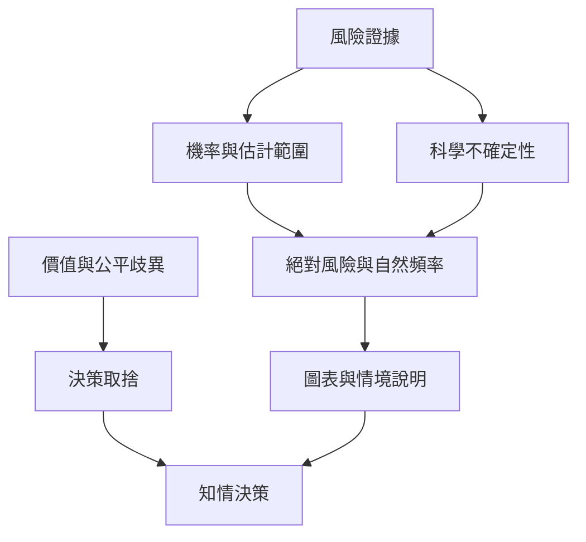

風險數字必須與族群、期間、分母、比較基準和證據限制一起呈現。科學不確定性、價值歧異與風險偏好不能混為一談；圖像化能協助理解，但要以受眾實際決策為設計中心。

可連結[[透明揭露不確定性比營造絕對確定更有助於信任]]、[[風險訊息需要區分機率不確定與價值歧異]]、[[絕對風險與自然頻率能降低數字表述造成的誤解]]及[[風險圖表必須呈現分母與時間範圍]]。

本圖屬於[[Risk_communication]]。
