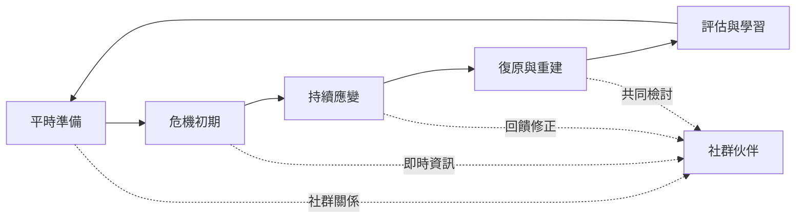

危機溝通需要從平時準備延伸到初期應變、持續管理、復原與事後學習。每個階段都要維持對話、同理與具體行動，並在證據改變時公開修正。

核心筆記：[[危機溝通六原則要求快速、準確、可信、同理、可行與尊重]]、[[危機溝通需要跨機構協調但不能抹平地方差異]]、[[可行的防護行動必須同時具備資訊與資源]]、[[危機後公開修正紀錄是重建信任的一部分]]。

本圖屬於[[Risk_communication]]。
