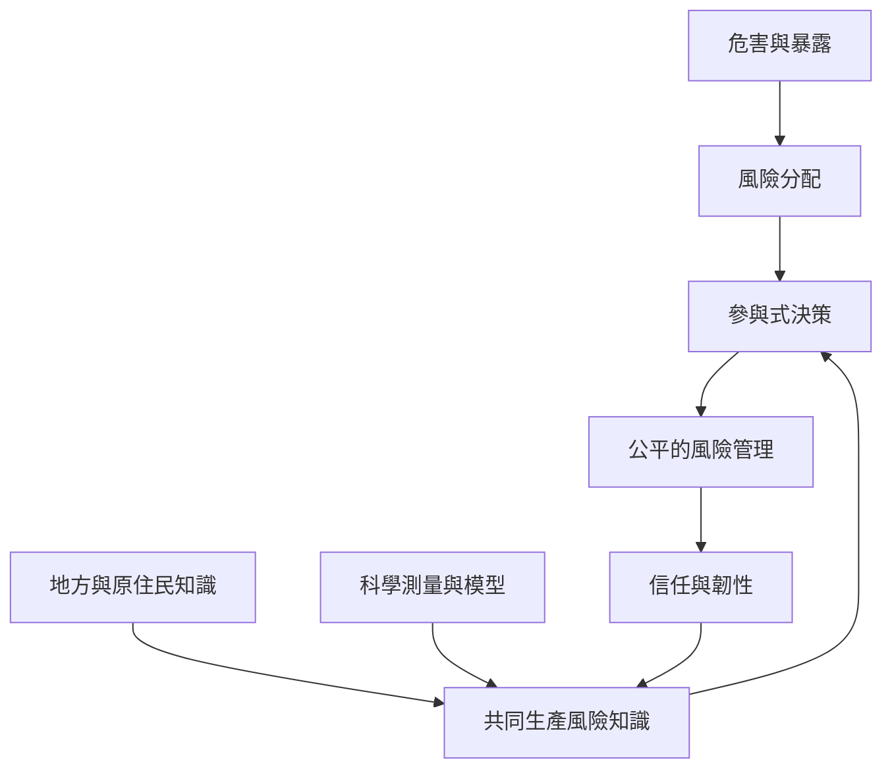

風險不只是自然或技術事件，也是一種社會分配問題。環境正義要求看見誰承擔風險、誰獲得利益、誰的知識被承認，以及誰能參與決策。地方知識與科學共同生產，能補充風險評估的盲點。

核心筆記：[[風險溝通必須揭露風險與利益如何分配]]、[[風險知識需要由專家與地方共同生產]]、[[風險脆弱性往往來自社會條件而不只是危害強度]]及[[風險溝通不能以操控取代知情自主]]。

本圖屬於[[Risk_communication]]。
