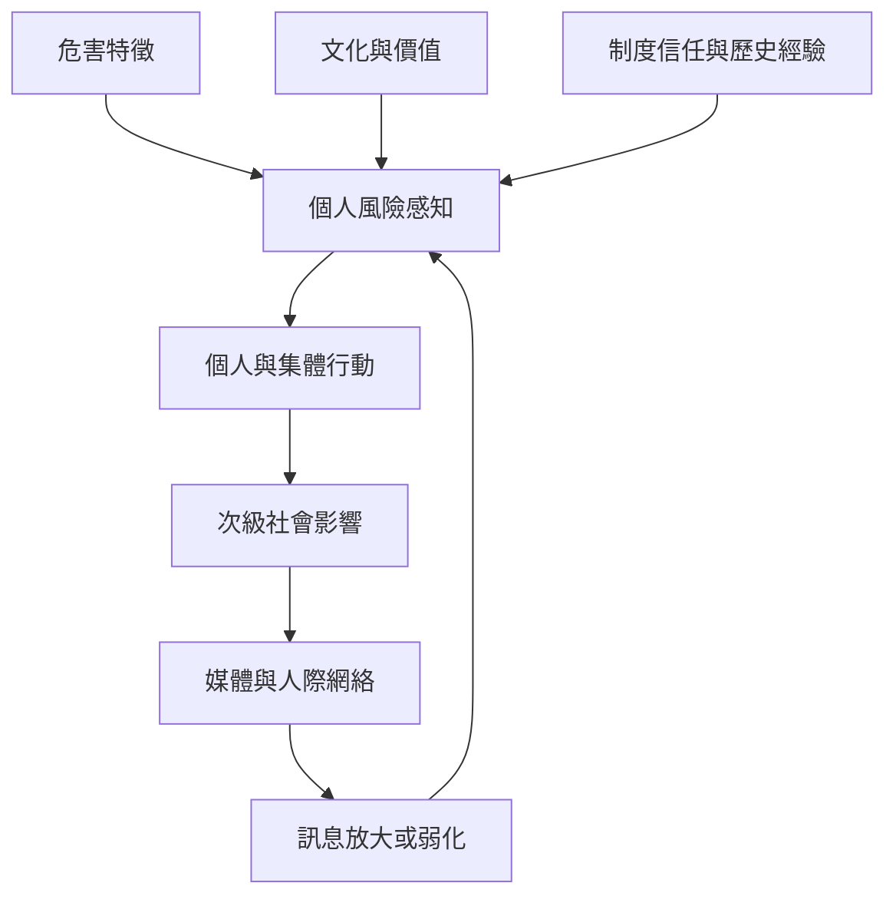

風險感知由心理、文化、制度信任與生活經驗共同構成；風險訊息又會經過媒體、組織與人際網絡被重新詮釋，可能造成風險放大或弱化。分析時必須同時注意個人判斷和社會資訊環境。

核心筆記：[[專家估算的風險與居民感受到的風險可能不同]]、[[風險感知由心理文化與社會條件共同形成]]、[[媒體與人際網絡會共同塑造風險資訊環境]]、[[風險溝通必須同時觀察風險放大與風險弱化]]。

本圖屬於[[Risk_communication]]。
