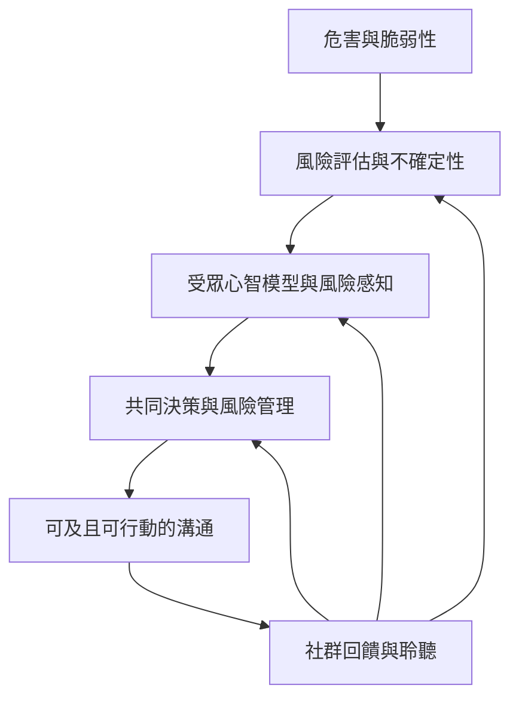

風險溝通可以理解為一個持續循環：先辨識危害與脆弱性，再理解不同群體如何感知風險，接著共同評估和管理，並透過可及訊息、社群參與與回饋持續修正。它不是單向的傳播漏斗，而是治理系統的一部分。

主幹概念包括[[風險溝通是持續的雙向交換而非單向資訊發布]]、[[風險溝通應先診斷受眾的理解方式再安排內容]]、[[透明揭露不確定性比營造絕對確定更有助於信任]]及[[社群參與必須讓居民能影響決策而不只是提供意見]]。文獻基礎見[[風險溝通必須在危機前建立能力而不是臨時發布訊息]]、[[風險溝通的品質取決於決策程序而不只是訊息文案]]。

本圖屬於[[Risk_communication]]。
