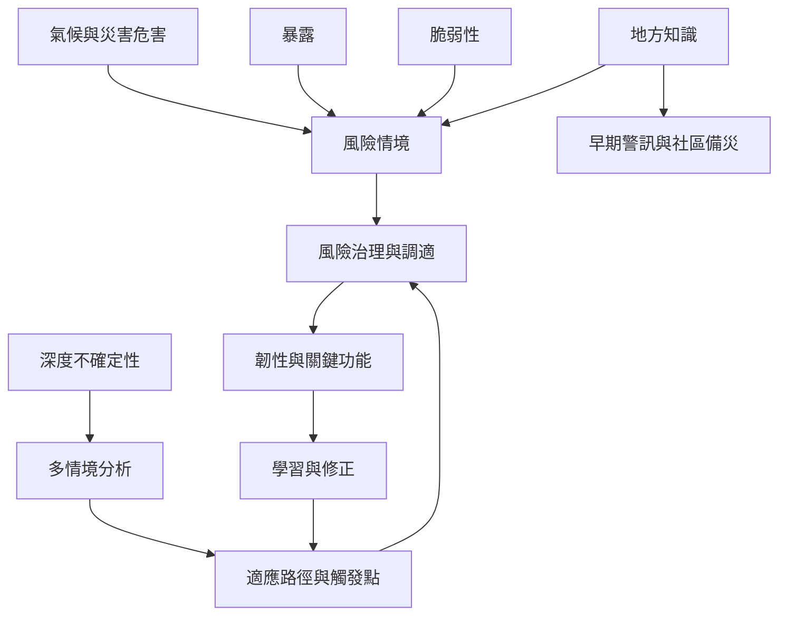

此地圖將災害風險、地方知識、深度不確定性與韌性連在一起。災害治理需同時處理危害、暴露、脆弱性與能力，並透過社區參與及跨部門治理建立可持續的預防、備災、應變與復原能力。

## 概念連結
* [[韌性]]、[[能力]]、[[脆弱性]]、[[暴露]]、[[危害]]、[[深度不確定性]]、[[預防原則]]。
* 永久筆記：[[地方知識能補足專業模型未捕捉的風險訊號]]、[[韌性要求系統在干擾中維持關鍵功能並學習]]、[[深度不確定性下應設計可調整的政策路徑]]。
* 文獻：[[仙台減災綱領要求理解風險並賦權地方參與]]、[[IPCC指出深度不確定性需要適應路徑與持續調整]]、[[台灣原住民族部落研究顯示地方經驗能辨識災害前兆]]。
