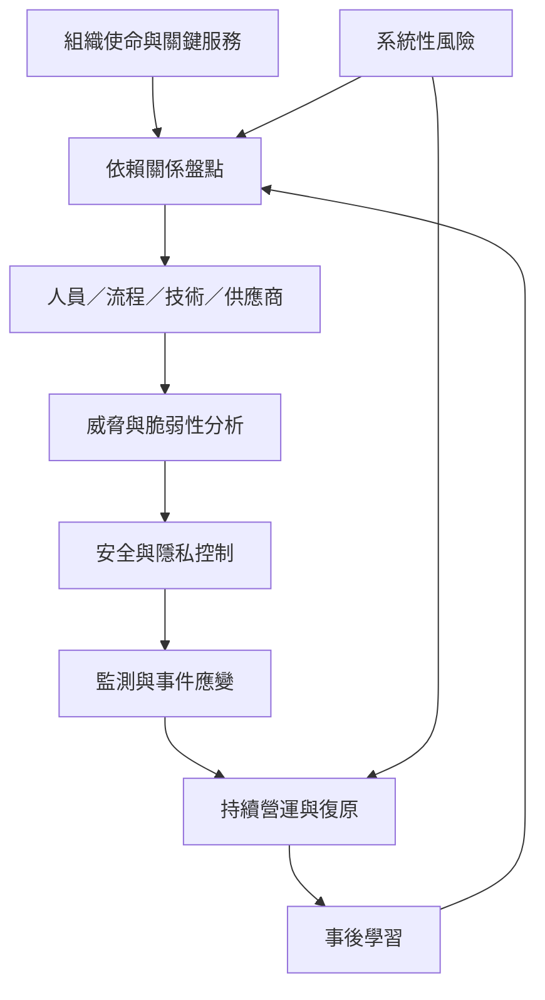

此地圖從組織層級檢視營運、資訊安全、隱私、第三方依賴與重大中斷。[[營運韌性]]不只是技術備援，而是治理、關鍵服務定義、依賴關係映射、控制措施、事件應變與持續學習的整合結果。

## 概念連結
* [[營運韌性]]、[[系統性風險]]、[[風險管理]]、[[風險評估]]、[[韌性]]。
* 永久筆記：[[系統性風險會沿著依賴關係跨領域傳播]]、[[多層防線能降低單一錯誤演變成重大事故的機率]]、[[監測的價值在於觸發重新判斷，而不只是蒐集數據]]。
* 文獻：[[NIST風險管理框架把資安與隱私納入系統生命週期]]、[[巴塞爾委員會把營運韌性納入銀行風險監理]]、[[Reason指出組織事故往往來自多層防線的漏洞對齊]]。
