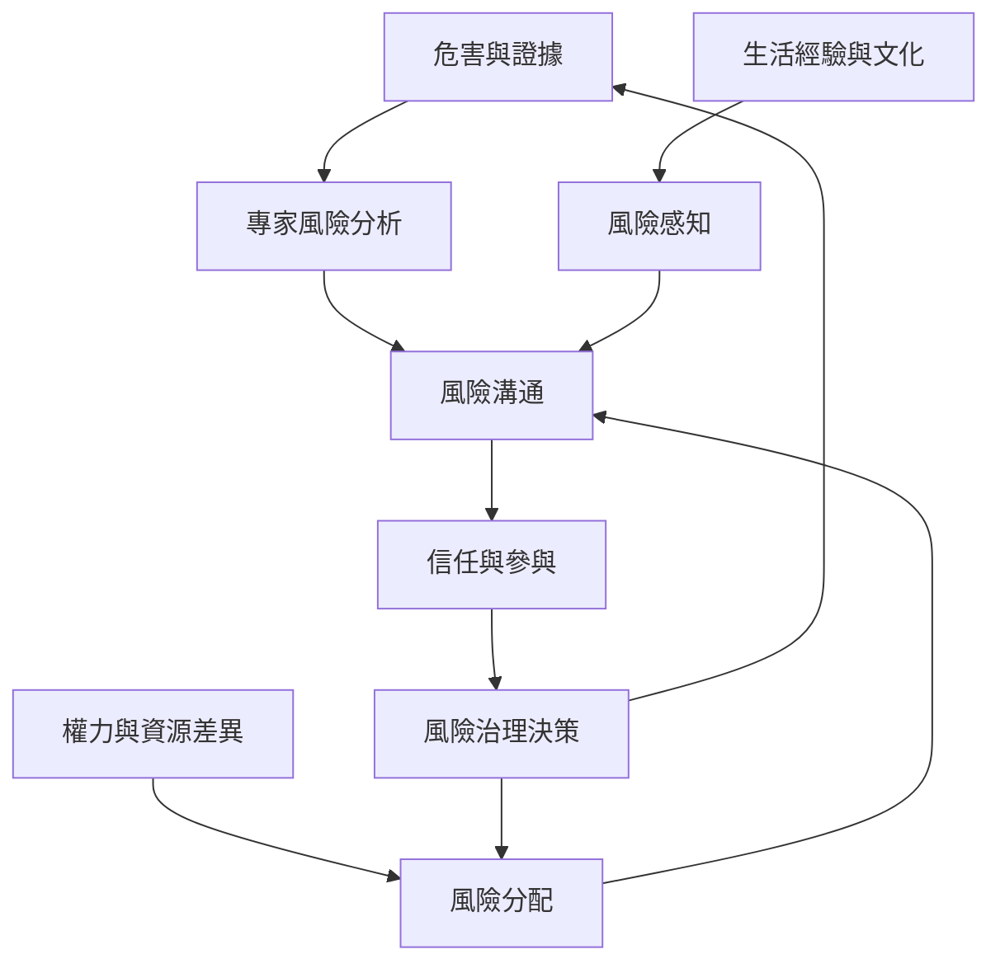

風險不是只有專家模型中的機率與影響，也存在於人們的經驗、制度信任、文化排序與資源分配中。此地圖連結[[風險溝通]]、[[風險治理]]與[[風險分配]]，提醒讀者注意誰的知識被採納、誰的擔憂被視為合理，以及誰承擔殘餘風險。

## 概念連結
* [[風險溝通]]、[[風險治理]]、[[風險分配]]、[[脆弱性]]、[[殘餘風險]]。
* 永久筆記：[[風險感知受到可怕程度控制感與信任影響]]、[[風險文化決定社會注意哪些危險]]、[[風險溝通必須建立雙向理解與信任]]。
* 文獻：[[Slovic指出風險感知不等同於機率計算]]、[[Douglas與Wildavsky指出風險選擇受到文化與社會秩序影響]]、[[美國國家研究委員會指出風險溝通也是程序與信任問題]]。
