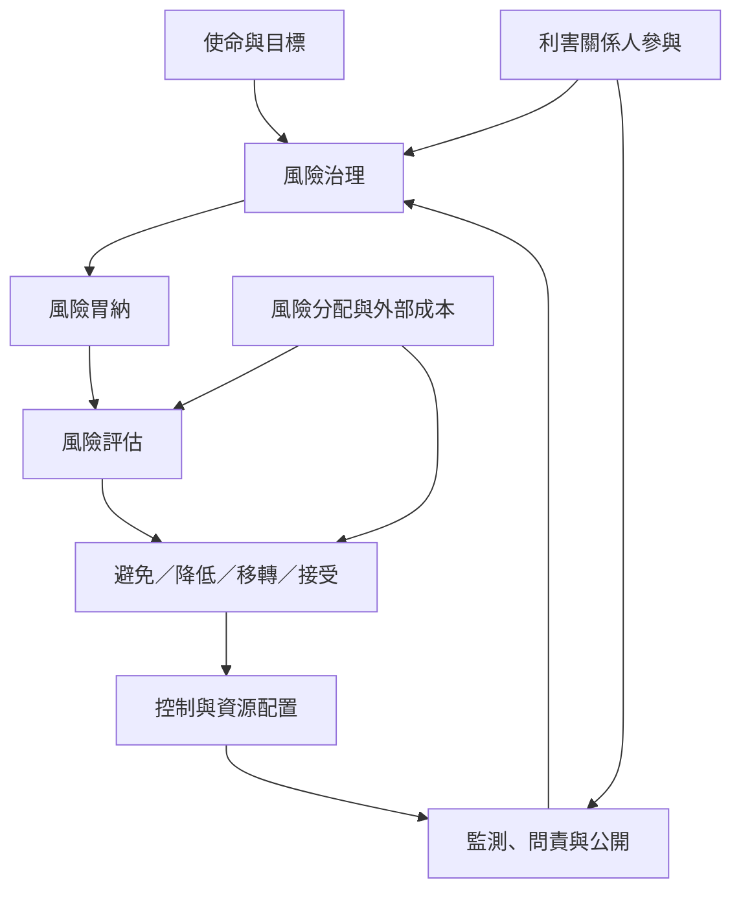

風險治理地圖聚焦誰設定目標、誰定義可接受風險、如何選擇控制措施，以及決策如何被監督。風險管理應與策略相連，但不能只以組織績效作為唯一價值。[[風險胃納]]、[[風險治理]]、[[風險分配]]與[[風險移轉]]共同構成決策的權力與責任面向。

## 概念連結
* [[風險治理]]、[[風險胃納]]、[[風險處理]]、[[風險移轉]]、[[風險分配]]、[[殘餘風險]]。
* 重要觀點：[[風險管理是治理與學習的循環，而不是一次性的風險清單]]、[[風險胃納是價值選擇，不是純粹的技術參數]]、[[風險管理必須揭露風險的分配與外部成本]]。
