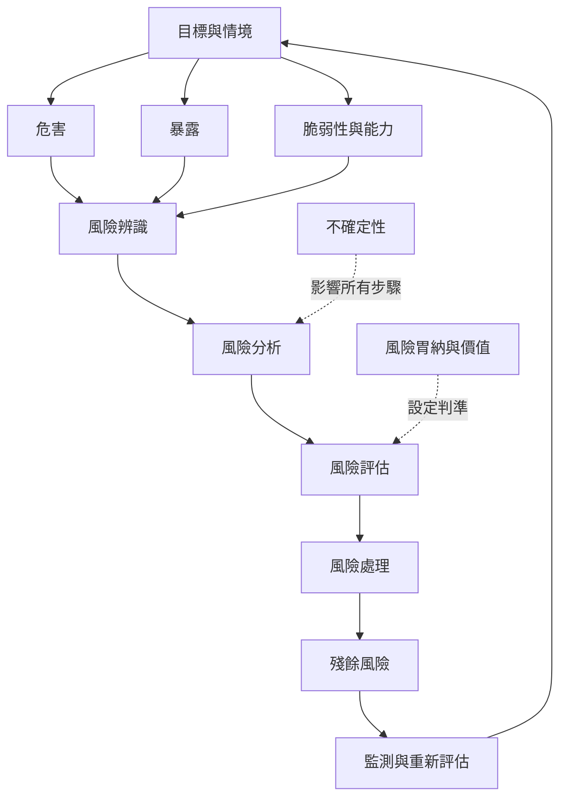

本概念地圖整理風險的核心構成、評估程序與常見認知陷阱。閱讀時先區分[[風險]]、[[危害]]、[[暴露]]與[[脆弱性]]，再進入[[風險評估]]、[[風險分析]]及[[風險處理]]。風險矩陣只是排序工具，不應取代情境理解和不確定性揭露。

## 概念連結
* [[風險]]、[[風險管理]]、[[危害]]、[[暴露]]、[[脆弱性]]、[[能力]]、[[不確定性]]。
* [[風險評估]]、[[風險分析]]、[[風險處理]]、[[風險胃納]]、[[殘餘風險]]、[[預防原則]]。
* 永久筆記：[[風險評估必須先界定目標與情境]]、[[災害風險不是危害本身，而是危害與暴露及脆弱性的互動]]、[[風險矩陣不能把未知轉成虛假的精確度]]。
