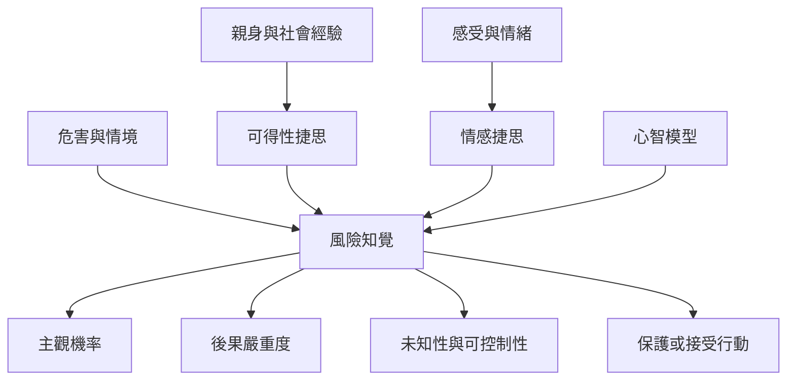

這張圖整理風險知覺如何由多種心理線索共同形成：人們評估危害時，會用到情感、記憶可得性、經驗，以及對未知與控制能力的判斷。這些機制不能單獨解釋全部風險行為，必須放回具體情境。

## 概念連結
* [[風險知覺]]、[[危害]]、[[風險]]、[[心理計量典範]]
* [[情感捷思]]、[[可得性捷思]]、[[心智模型]]、[[不確定性]]
* [[風險知覺必須分開機率判斷與價值評估]]、[[風險知覺是多維度而非單一恐懼分數]]、[[親身經驗會改變風險訊號的可得性]]
* [[風險判斷同時受未知性與恐懼程度塑造]]、[[人們會用社會網絡中的親身經驗估計風險]]
