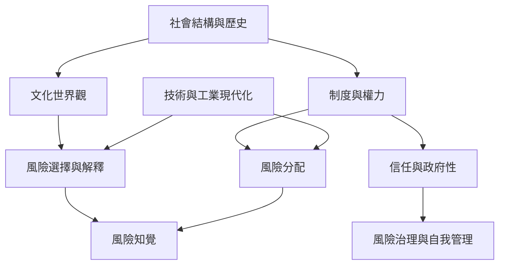

這張圖將風險放回社會關係：文化世界觀會影響哪些危害被看見，制度信任與治理方式影響風險解釋，科技與工業現代化則會創造新的風險分配與知識政治。

## 概念連結
* [[文化理論]]、[[風險社會]]、[[政府性]]、[[信任]]
* [[環境正義]]、[[脆弱性]]、[[風險知覺]]
* [[文化世界觀影響人們把哪些危害視為重要]]、[[風險的分配不平等也決定誰能定義風險]]
* [[文化價值決定社會選擇注意哪些危害]]、[[風險社會把危害分配與知識政治放到現代性中心]]
