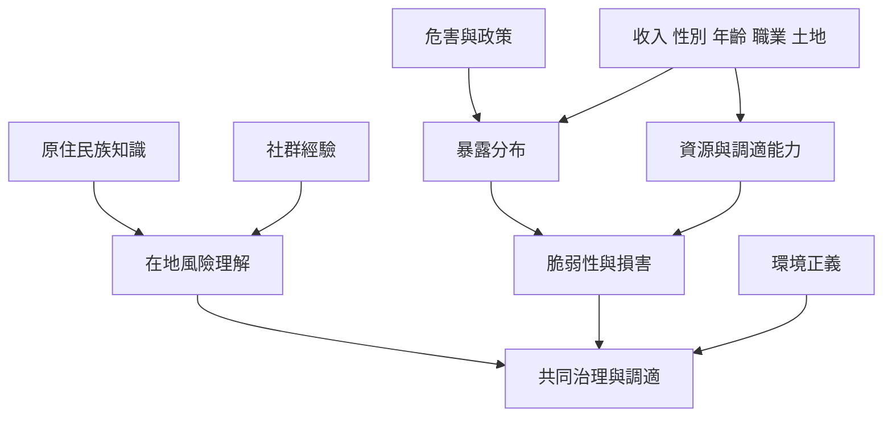

風險不平等不只是危害發生機率不同，也涉及誰暴露、誰有能力避險、誰能參與決策，以及誰的經驗被視為知識。地方知識與原住民族知識應被納入治理，同時尊重其權利與情境脈絡。

## 概念連結
* [[環境正義]]、[[脆弱性]]、[[原住民族知識]]、[[在地知識]]
* [[風險社會]]、[[風險知覺]]、[[危害]]
* [[地方知識是風險治理的知識來源而非噪音]]、[[風險暴露與承擔能力同樣決定實際脆弱性]]
* [[太平洋防災需要把原住民族與地方知識納入制度]]、[[環境風險的暴露與代價呈現種族階級不平等]]
