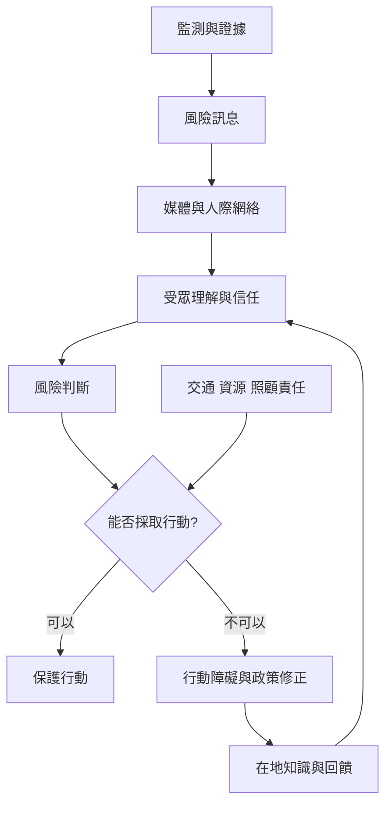

風險溝通不是單向傳遞資訊，而是將證據、制度信任、社群知識與可行動條件連接起來。警報要轉化為保護，必須先能抵達、被理解、被信任，並且有資源採取行動。

## 概念連結
* [[風險溝通]]、[[信任]]、[[不確定性]]、[[社會放大架構]]
* [[心智模型]]、[[保護行動決策模型]]、[[在地知識]]
* [[警報只有可接收可理解可行動才會轉化為保護]]、[[風險溝通應將未知與修正機制說清楚]]
* [[孟加拉沿海居民不撤離是多重生活限制的結果]]、[[公共衛生風險溝通應公開未知數並建立信任]]
