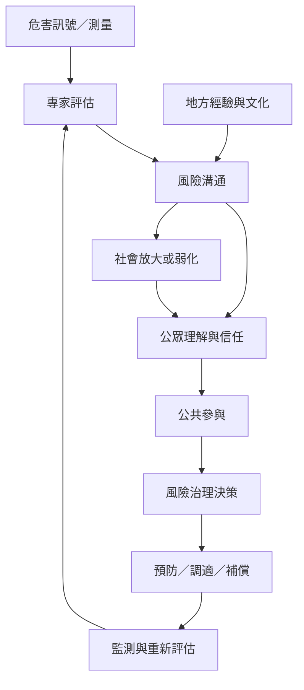

風險治理是資訊、價值、制度與行動的協作，而非單純把專家評估傳遞給民眾。風險感知與社會放大過程影響公共反應；透明表達不確定性、公開資料與建立申訴制度，是累積信任和調整政策的重要條件。預防原則要求在未知仍存在時負責任行動，同時為政策副作用留下檢查機制。

連結：[[風險治理]]、[[風險溝通]]、[[風險感知]]、[[社會放大風險]]、[[預防原則]]、[[知識不正義]]。

回到導讀：[[Risk_society]]。
