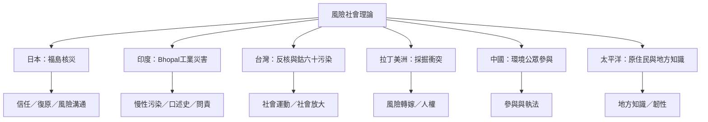

案例比較顯示，風險社會理論需要落到不同歷史與制度脈絡中檢驗。福島凸顯核風險、長期復原與專家信任；博帕爾凸顯工業污染與受害者政治；台灣核能與鈷六十案例呈現跨國事件、地方運動及社會放大；拉丁美洲採掘衝突、中國環境參與與太平洋地方知識則拓展全球比較的範圍。

連結：[[福島重建政策無法取代居民對家園的複雜感受]]、[[Bhopal的長期毒害催生持續的環境正義政治]]、[[台灣福島效應改變反核運動的政治聯盟]]、[[台灣鈷六十污染事件顯示風險會經社會放大]]、[[拉丁美洲資源開採把環境衝突與人權綁在一起]]、[[中國制度化公眾參與能改變地方環境執法]]、[[原住民與地方知識應成為太平洋減災的一部分]]。

回到導讀：[[Risk_society]]。
