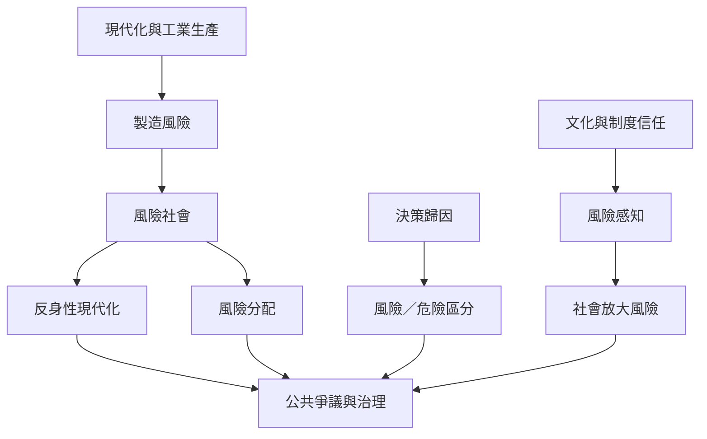

這張地圖整理風險社會的理論主軸：現代化製造副作用，制度回頭檢視自身（反身性現代化），而未來損害如何被歸因、命名與治理，成為知識和政治衝突。Beck 的宏觀診斷需與 Luhmann 的風險／危險區分、Douglas 的風險文化觀點互相參照。

連結：[[風險社會]]、[[反身性現代化]]、[[製造風險]]、[[風險]]、[[危險]]、[[風險文化]]、[[風險感知]]、[[風險治理]]。

回到導讀：[[Risk_society]]。
